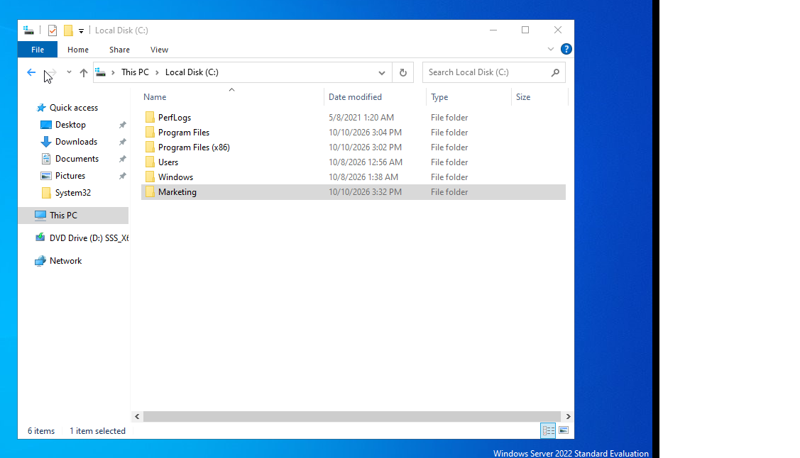
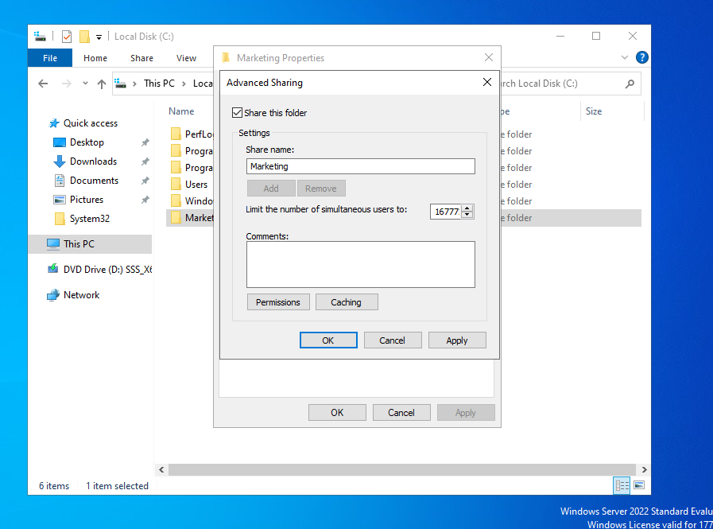
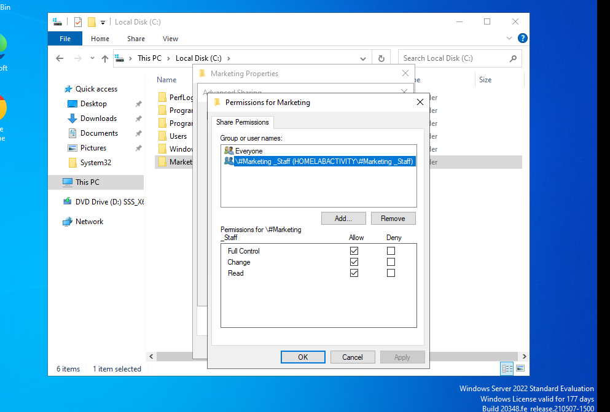
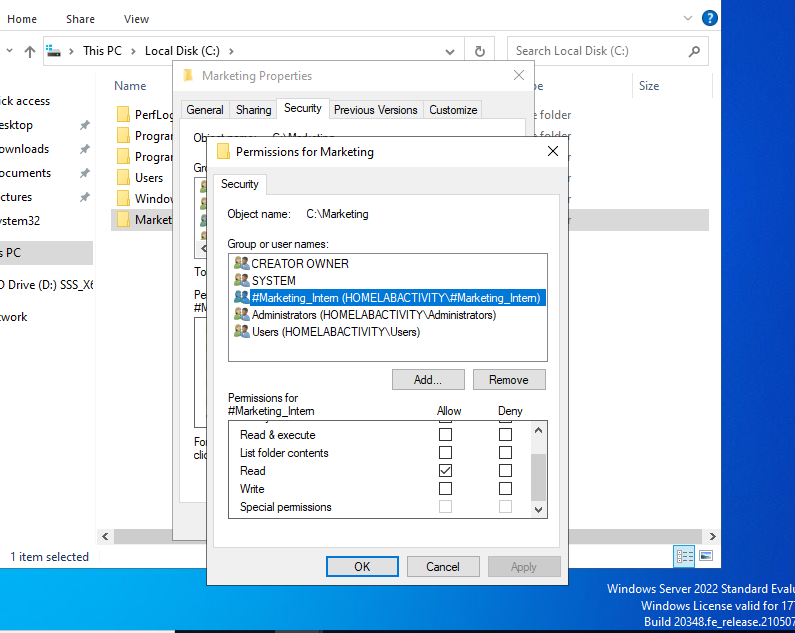
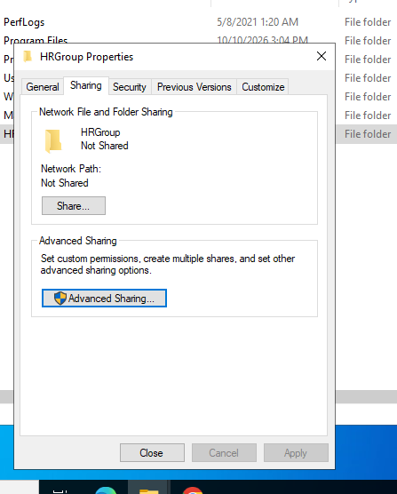
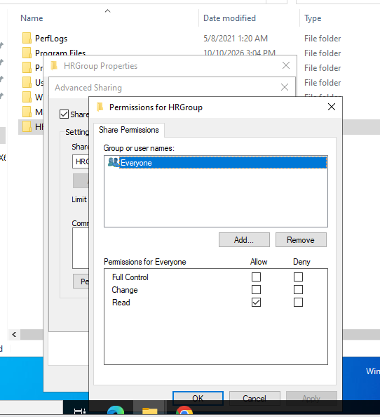
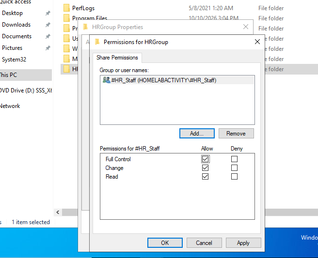
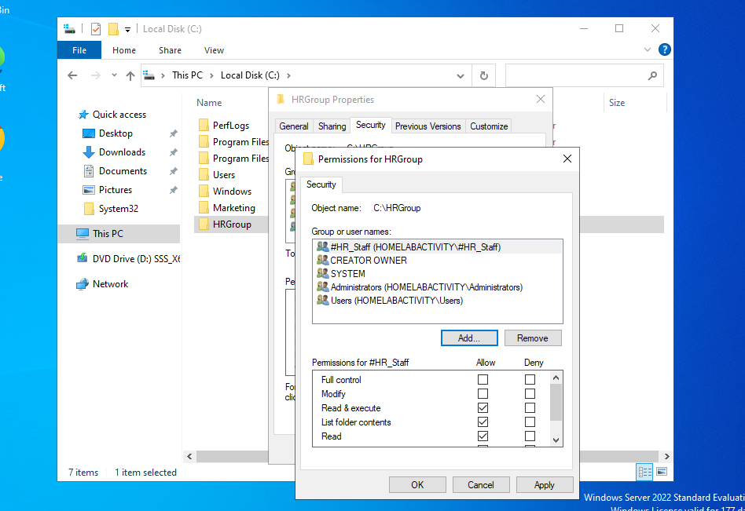

# File Sharing: NTFS vs Shared Folder Permissions+

## Description

A practical lab walkthrough demonstrating how to configure network file sharing, Share Permissions, and NTFS Security Permissions on Windows Server 2022. This activity illustrates the principle of combining Share and NTFS permissions to implement precise access controls based on specific organizational user roles and scenarios.

## Environment Used

- Windows Server 2022 (Domain Controller)
- Windows 10 Enterprise (Domain-Joined Client Workstation)
- VMware Workstation

## Lab walk-through

### Activity 1: Granting Read-Only Access to a Marketing Intern
### Scenario

A Marketing Intern needs access to the Marketing Team’s shared folder ("Marketing") to view content but should not modify or delete files.  

##

Navigate to Local Disk (C:) on the file server and create the target shared directory named "Marketing"
  

Open folder Properties, navigate to the Sharing tab, and click "Advanced Sharing" to enable network sharing for the Marketing folder.
  

Configure Share Permissions by granting the #Marketing_Staff group Full Control / Change / Read access at the network share level.
  

Configure NTFS Security Permissions under the Security tab by granting the #Marketing_Intern   group Read & execute, List folder contents, and Read permissions while ensuring Write permission is unchecked.
  

##

### Activity 2: Restricting Access to HR Department Share
### Scenario

The HR Department needs a secure folder "HRGroup" that only HR staff can access. Other employees should not see or access the folder at all.
##

Access folder Properties for HRGroup and open the Sharing tab to initiate network sharing options.
  

Open Share Permissions and inspect default permissions assigned to the Everyone group.
  

emove the Everyone group and explicitly grant Full Control, Change, and Read share permissions exclusively to the #HR_Staff security group
  

: Configure NTFS Security Permissions under the Security tab to ensure the #HR_Staff group is   granted Read & execute, List folder contents, and Read access on the file system level.
  

##

### Activity 3: Restricting Access to HR Department Share
### Scenario

The HR Department needs a secure folder "HRGroup" that only HR staff can access. Other employees should not see or access the folder at all.
##

Access folder Properties for HRGroup and open the Sharing tab to initiate network sharing options.
  

Open Share Permissions and inspect default permissions assigned to the Everyone group.
  

emove the Everyone group and explicitly grant Full Control, Change, and Read share permissions exclusively to the #HR_Staff security group
  

: Configure NTFS Security Permissions under the Security tab to ensure the #HR_Staff group is   granted Read & execute, List folder contents, and Read access on the file system level.
  

